

  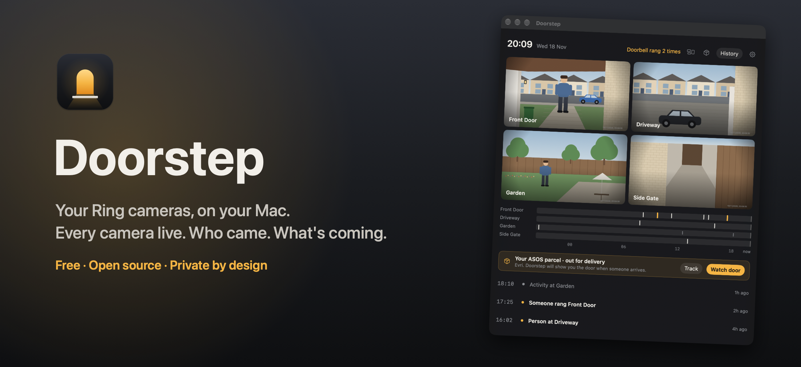

  

  
  
  
  
  

  <a href="#install-in-two-minutes">Install</a> ·
  <a href="#what-it-does">What it does</a> ·
  <a href="#screenshots">Screenshots</a> ·
  <a href="docs/guides/README.md">Guides</a> ·
  <a href="FAQ.md">Questions</a> ·
  <a href="#privacy">Privacy</a> ·
  <a href="CONTRIBUTING.md">Contribute</a>

---

**Doorstep puts your Ring doorbell and cameras on your Mac.** Every camera live at once in your menu bar, a timeline of your day, and a little intelligence on top: it tells you *who* came (the DPD driver, the postie, someone knocking who didn't ring), keeps track of the parcels you're waiting for, and can record your cameras on your Mac even if you don't pay for a Ring subscription.

It's free, it's open source, and nothing goes to us. There is no "us": no account, no server, no tracking. Your Mac talks to Ring, and that's it.

  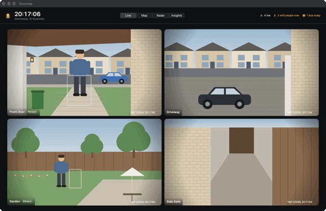

> **Unofficial.** Doorstep is not made by, endorsed by or connected to Ring or Amazon. It signs in to your own Ring account the same way Ring's apps do. See [the honest bit](#the-honest-bit).

## Install in two minutes

1. **[Download Doorstep](https://github.com/iinde/doorstep-releases/releases/latest)** (the file ending in `.dmg`).
2. **Open it and drag Doorstep into Applications.**
3. **Open Doorstep from Applications.** The first time, macOS may say it can't check the app. Open **System Settings › Privacy & Security**, scroll down, and click **Open Anyway**. You only do this once.

Doorstep appears in your menu bar (look for the little lit doorway at the top of your screen). Click it, sign in with your Ring email and password, type the code Ring texts you, and your cameras appear.

From then on **Doorstep updates itself**: when there's a new version you'll get a window with what's new and an Install button.

More help: [Getting started](docs/guides/getting-started.md) · [Why the "Open Anyway" step?](FAQ.md#why-does-macos-say-it-cant-check-doorstep)

## What it does

### See everything, instantly
- **Every camera live, side by side**, right from the menu bar. Click one to make it big.
- **A timeline of your day** under the cameras. Every mark is something that happened; amber means someone rang.
- **The doorbell pops up when someone rings**, like a FaceTime call, with **Hold to talk**.
- **It sees people walking up**, and shows you the door before they've even rung.
- **Float any camera** in a little window that stays on top while you work.
- **Only the cameras you want.** Hide any camera, or a whole shared location, in Settings.

### Know who it was
- **Couriers by name.** Doorstep reads "DPD", "Royal Mail", "Amazon", "Evri", "DHL" and more off vans, jackets and bags, so you see *"DPD left a parcel"*, not *"Motion detected"*.
- **It learns your regulars.** Tell it "that was Royal Mail" once and it recognises them next time.
- **It listens, too.** Knocking, dogs barking, breaking glass, alarms. *"Someone knocked at Front Door"* shows up even when nobody pressed the bell.
- **Parcel left. Parcel taken.** The doorbell notices a parcel arriving on your step, and warns you if one disappears.
- **Number plates** (off unless you switch it on): name your car and Doorstep tells you when it's home.
- **Search your history in plain English**: *"DPD last week"*, *"person at the garden yesterday evening"*, *"knock"*.

### Parcels, sorted
- **"I'm expecting a parcel."** Paste a tracking number. Doorstep works out the carrier, reminds you on the day, and shows you the door when someone arrives.
- **Drop in delivery emails** from Mail or Outlook and it reads the tracking for you.
- **Every delivery is matched to the clip** of it arriving, so you can watch the moment it came.
- **Rain warning** if a parcel's been left out in the rain.

### Alerts that make sense
- **Choose what alerts you**: the doorbell, people, parcels, vehicles, animals, familiar faces, unusual activity, or any movement.
- **One alert per visit.** The courier who walks up, rings and leaves doesn't send you five notifications; the same alert updates.
- **Every alert says what happened** in a plain sentence: *"A DPD courier walked up to the front door, rang the doorbell and left a parcel."*
- **Home, Away, Night and Quiet modes**, like an alarm panel: each decides which cameras alert you and which record. Switch from the Wall, on a schedule, or with *"Set Doorstep to Away"*.
- **Familiar faces** (off unless you switch it on): name the people you know and get *"Mum is at the front door"*.
- **Unusual activity**: someone in the garden at 3am, when that never happens, gets flagged.

### Record without a Ring subscription
- **Your Mac becomes the recorder.** Without Ring's subscription, Ring keeps no video at all. Doorstep can keep chosen cameras live, spot people itself, and save each visit with the few seconds *before* it, to a folder you choose (a network drive works).
- **24/7 recording** on wired cameras, in 10-minute files, kept for as long as you choose (up to "until I delete them").
- **Time-lapse for battery cameras**: a still every few minutes, turned into a video of the day.
- **Your day in 60 seconds**: one button makes a short video of everyone who came, with times on screen.

### A proper command centre
- **Full screen, every camera** (⌘K).
- **Map**: your home from above, each camera where it really is, and a trail when someone walks round the house.
- **Radar**: live blips for people your cameras can see right now.
- **Insights**: your busiest hours, when the postie usually comes, and anything out of the ordinary.

### Works with the rest of your Mac
- **Automations**: when the doorbell rings or someone walks up after dark, run any Shortcut. Turn the porch light on, pause the music, message yourself a photo.
- **Siri and Shortcuts**: *"Show my door in Doorstep"*, *"What happened at home in Doorstep"*.
- **Spoken announcements** in a British voice, if you want them.
- **Add to Calendar** for the day a parcel's due.

### Private by design
- **No account, no server, no tracking.** Everything Doorstep works out (who came, what was heard, which plates) is worked out on your Mac.
- **The microphone is only on while you hold Talk.** Watching and recording never use it.
- **Anything that uses the internet beyond Ring is optional and uses your own key.** See [Privacy](#privacy).

Every feature, explained: **[the guides](docs/guides/README.md)**.

## Doorstep vs Ring Protect

Ring's subscription plans add recording and "intelligent" features to your cameras. Doorstep does almost all of it on your Mac, for free. It doesn't replace your Ring subscription if you have one: it works alongside it.

| Ring Protect feature (Solo £4.99 · Multi £7.99 · Pro £15.99 a month) | Doorstep |
|---|---|
| Video recording and history (up to 180 days) | ✅ Recorded on your Mac, kept as long as you like |
| 24/7 continuous recording (+£3/month per camera) | ✅ Wired cameras |
| Person, package and vehicle alerts | ✅ Plus animals, sounds and couriers by name |
| Extended live view | ✅ No time limit |
| Device modes (Home, Away…) | ✅ Home, Away, Night, Quiet |
| Doorbell calls | ✅ |
| Multi-camera live view | ✅ |
| Live view picture-in-picture | ✅ |
| Video preview alerts | ✅ A picture in every alert |
| Daily event summary | ✅ |
| Video descriptions (Pro) | ✅ On your Mac |
| Single event alerts (Pro) | ✅ |
| Video search (Pro) | ✅ |
| Familiar faces (Pro) | ✅ On your Mac, opt-in |
| Unusual event alerts (Pro) | ✅ |
| Save and share clips | ✅ |
| **Not in Ring Protect:** courier names, knock detection, parcel tracking, a map and radar of your cameras, Shortcuts automations, number plates, "your day in 60 seconds" | ✅ |
| Guard response, alarm call-outs, cellular backup | ❌ These need people and alarm hardware |
| Recording while your Mac is off | ❌ Doorstep records on your Mac, so it needs to be on. Ring records in its cloud. |

## Screenshots

> These pictures come from Doorstep's demo mode, with drawn cameras instead of a real home.

<table>
<tr>
<td width="50%">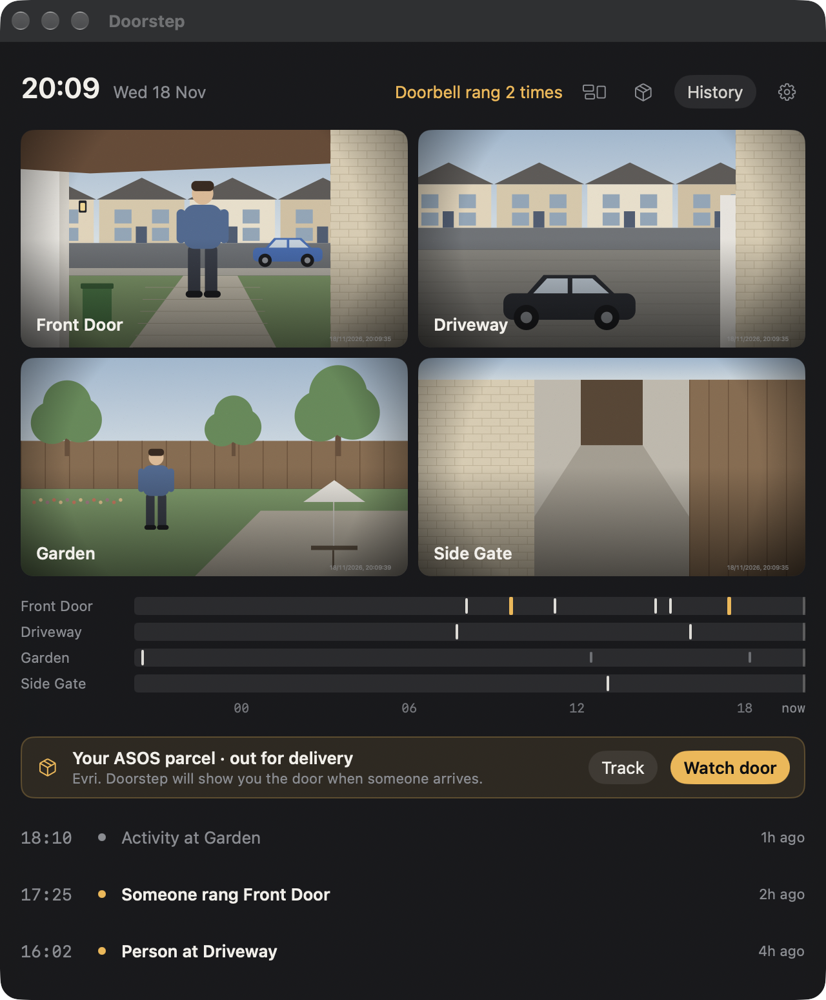 <b>The Wall.</b> Every camera, today's timeline, and what's coming.</td>
<td width="50%">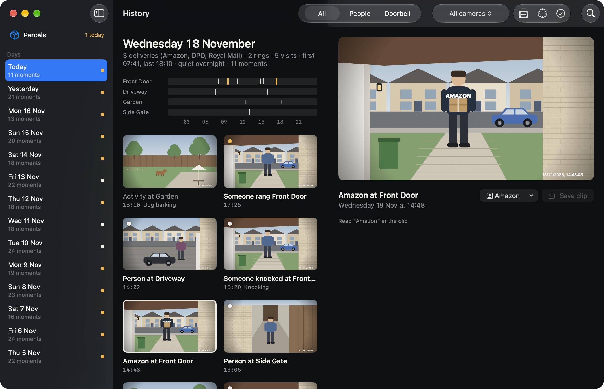 <b>History.</b> Every visit, who it was, and what was heard.</td>
</tr>
<tr>
<td>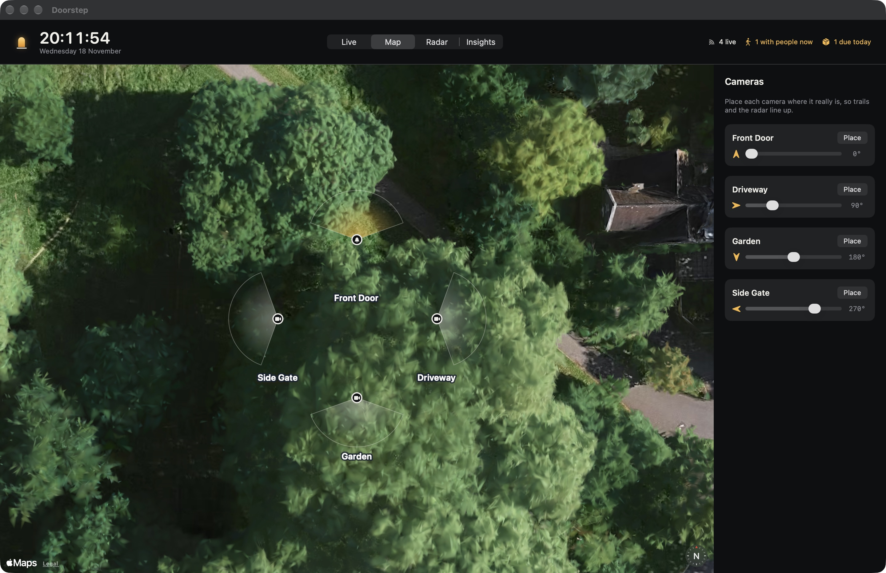 <b>Map.</b> Your cameras where they really are.</td>
<td>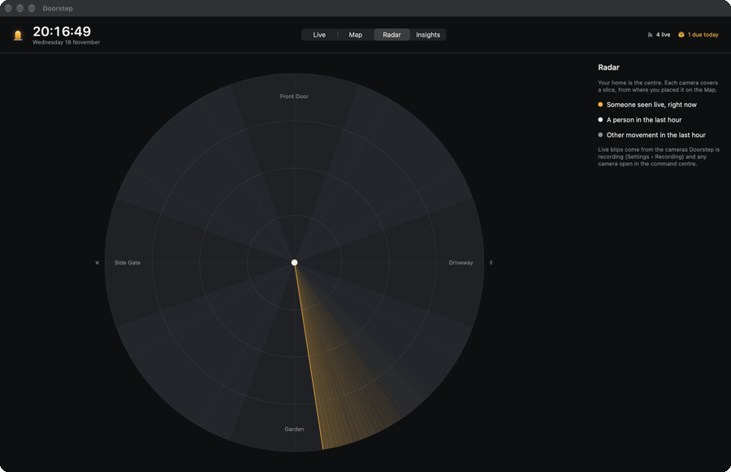 <b>Radar.</b> People your cameras can see, right now.</td>
</tr>
<tr>
<td>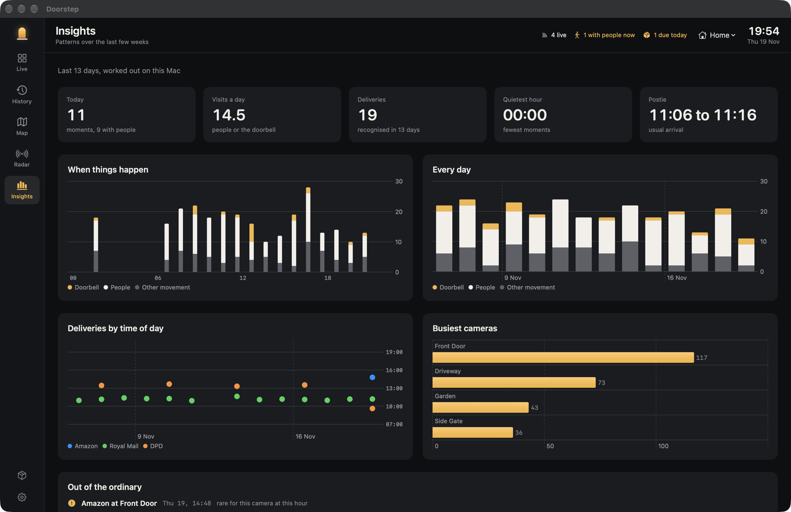 <b>Insights.</b> Busiest hours, deliveries, the postie's usual time.</td>
<td>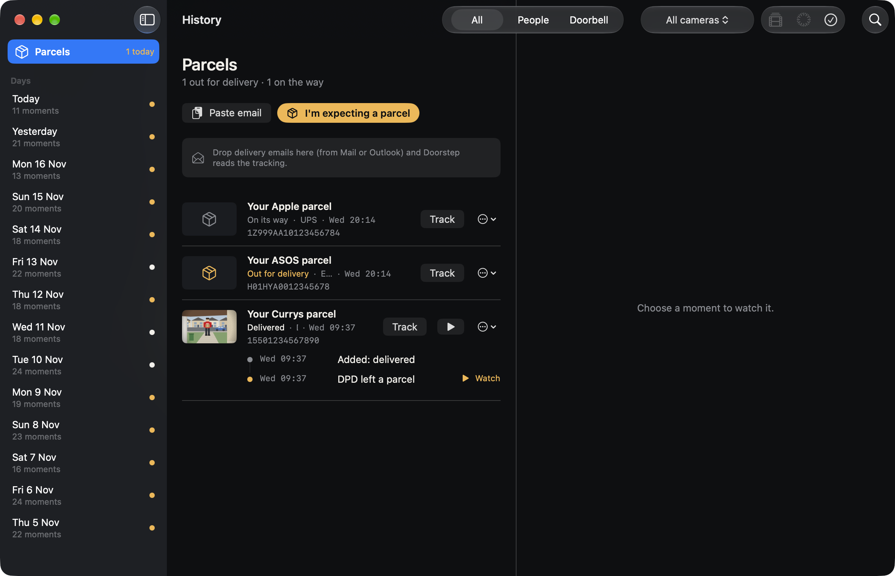 <b>Parcels.</b> What's coming, and the clip of it arriving.</td>
</tr>
<tr>
<td>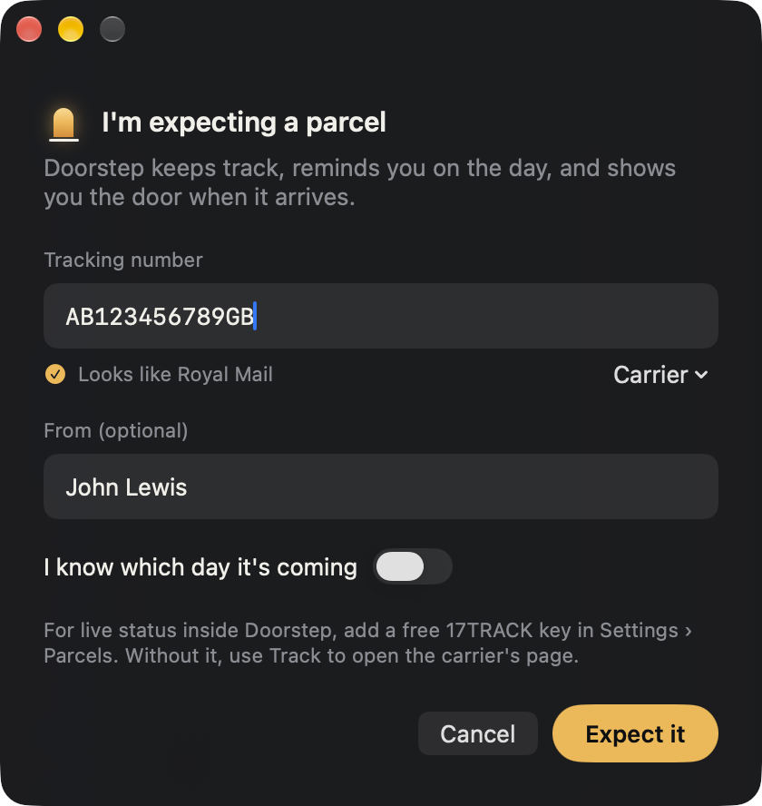 <b>"I'm expecting a parcel."</b> One number, Doorstep does the rest.</td>
<td>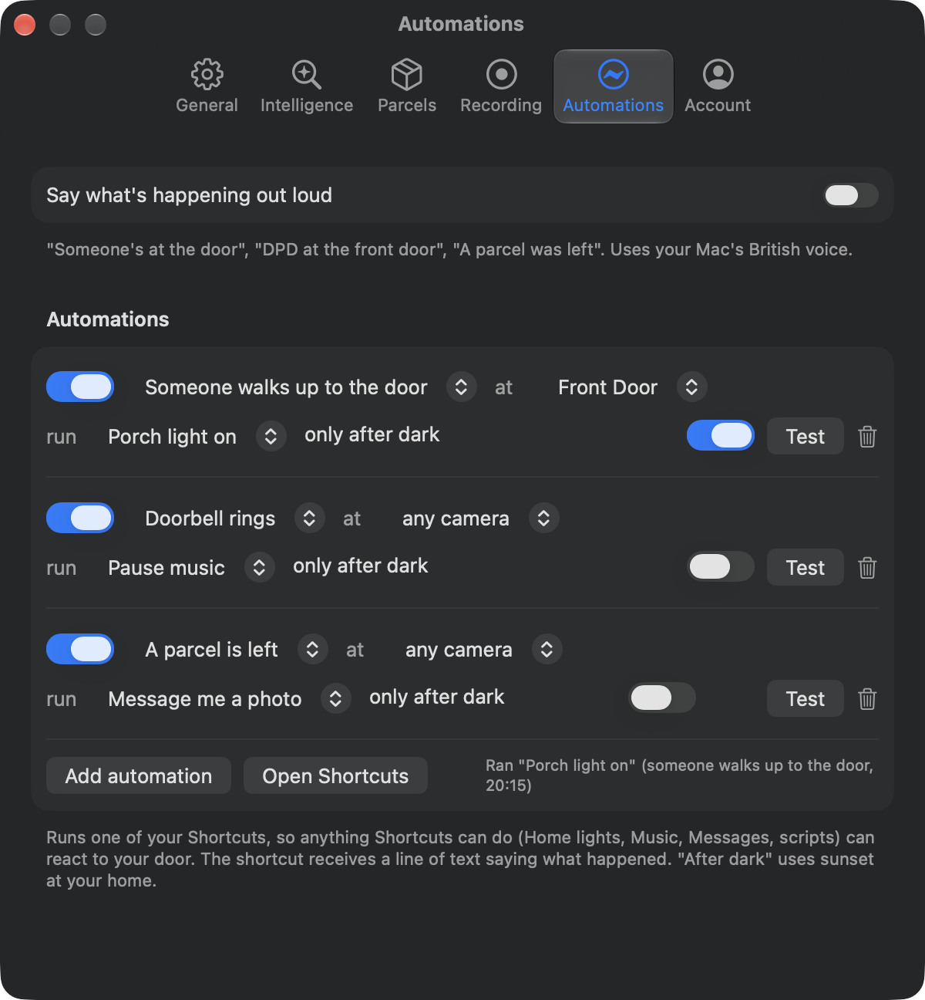 <b>Automations.</b> Your door, wired into Shortcuts.</td>
</tr>
<tr>
<td>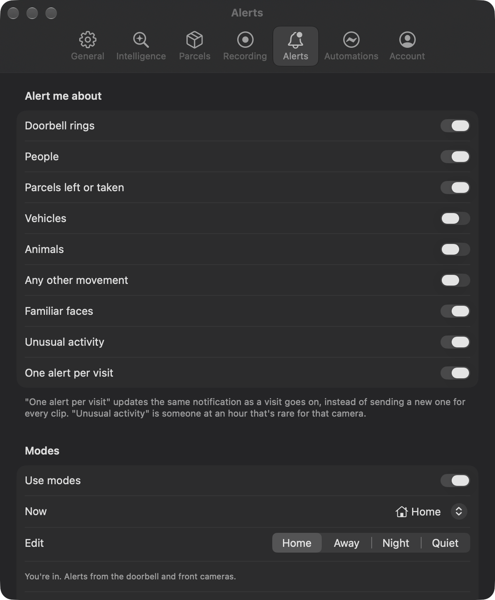 <b>Alerts and modes.</b> Only what matters, in the way you want it.</td>
<td></td>
</tr>
<tr>
<td>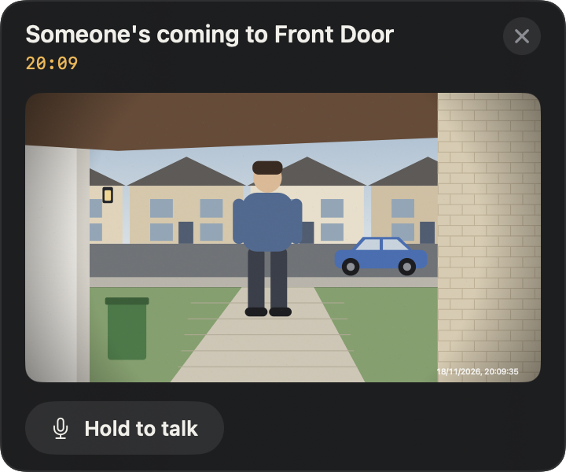 <b>Someone's coming.</b> The door, before they ring.</td>
<td>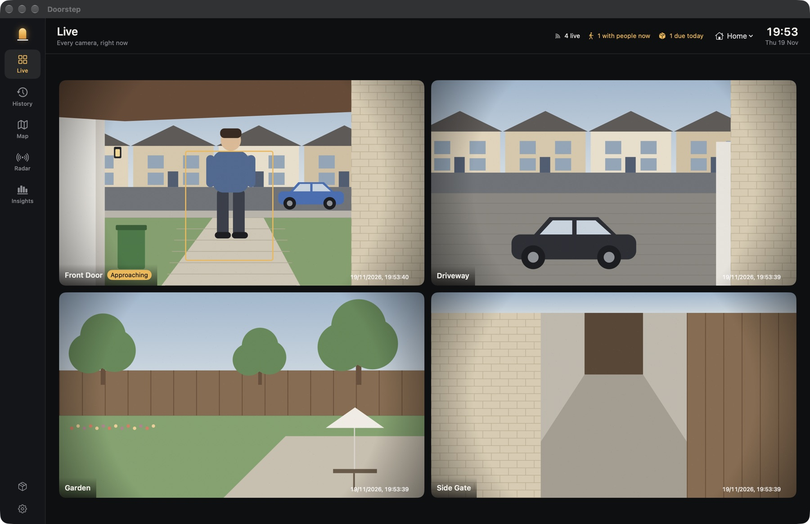 <b>Command centre.</b> Every camera, full screen.</td>
</tr>
</table>

## Privacy

Doorstep has no servers and no accounts of its own. Here is everything it ever sends anywhere:

| What | Goes to | When |
|---|---|---|
| Your Ring sign-in and camera video | **Ring**, as Ring's own apps do | Always (it's a Ring app) |
| Checking for updates | **GitHub**, where Doorstep is published | Every 6 hours, can be turned off |
| Three still frames of a visitor | **Anthropic (Claude)**, with *your own* key | Only if you switch on "Ask Claude" |
| Your tracking numbers | **17TRACK**, with *your own* key | Only if you add a key |
| Delivery emails (read-only) | **Microsoft**, your own mailbox | Only if you connect it |
| Your town, rounded to about 1 km | **Open-Meteo** (weather) | Only when a parcel's been left out |

Everything else stays on your Mac: who came, what was heard, number plates, recordings, your parcels, your settings. Your Ring password is kept in your Mac's Keychain. More in the [privacy guide](docs/guides/privacy.md).

**Recording your neighbours?** If your cameras see beyond your own property (the street, next door), privacy law can apply to you. In the UK, read the [ICO's guidance on domestic CCTV](https://ico.org.uk/for-the-public/domestic-cctv-systems-guidance-for-people-using-cctv/). Number plates are off by default for this reason.

## Questions

**Is it really free?** Yes. No subscription, no ads, no account. It's open source under the MIT licence.

**Do I need Ring Protect?** No. Live view, the doorbell, talking and Doorstep's own recorder all work without it. With Ring Protect you also get Ring's recorded clips in History.

**Does it work with my camera?** It's been used with Ring Video Doorbells, Floodlight Cam, Spotlight Cam and Stick Up Cam Mini. Most Ring doorbells and cameras should work. [Tell us](https://github.com/iinde/doorstep/issues/new?template=camera_report.yml) if yours doesn't.

**Is it safe?** The code is all here to read. Your password goes only to Ring and is stored in your Mac's Keychain. Updates are signed, and Doorstep refuses any update that isn't.

**Windows? iPhone?** Mac only, for now.

There are plenty more answers in **[the FAQ](FAQ.md)**.

## The honest bit

- **Doorstep uses Ring's private interface**, the one Ring's own apps use. Ring could change it at any time and break things until Doorstep catches up. Updates install themselves, so fixes reach you quickly.
- **It isn't notarised by Apple yet**, which is why macOS asks you to "Open Anyway" the first time. That costs an Apple Developer account; it's on the list.
- **The recorder needs your Mac to be on and awake.** Doorstep keeps it from sleeping while recording, but a closed laptop lid will stop it.
- **Recognising couriers works best in daylight.** At night the cameras switch to black and white, so Doorstep may just say "Delivery driver".

## Open source

Doorstep is built in Swift and SwiftUI, with WebRTC for live video, Apple's Vision and Sound Analysis for the on-device intelligence, and Sparkle for updates. Contributions are very welcome: bug reports, camera reports, translations, design, code.

- **[How to contribute](CONTRIBUTING.md)**, including how to build it yourself
- **[Report a bug](https://github.com/iinde/doorstep/issues/new?template=bug_report.yml)** · **[Ask for a feature](https://github.com/iinde/doorstep/issues/new?template=feature_request.yml)**
- **[What's changed](CHANGELOG.md)**
- **[Security](SECURITY.md)**: please report security problems privately

### Credits

Doorstep began from [open-ring](https://github.com/abracadabra50/open-ring) by its contributors (MIT licence), which worked out how to talk to Ring from a Mac. Updates by [Sparkle](https://sparkle-project.org). Live video by [WebRTC](https://webrtc.org).

## Licence

MIT. See [LICENSE](LICENSE). Ring is a trademark of Ring LLC, an Amazon company. Doorstep is an independent project and is not affiliated with them.
