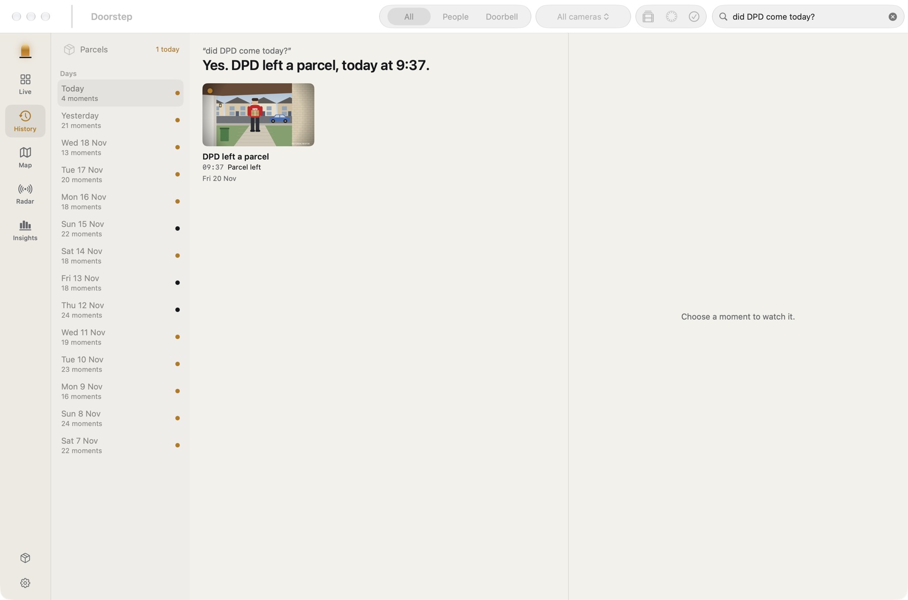
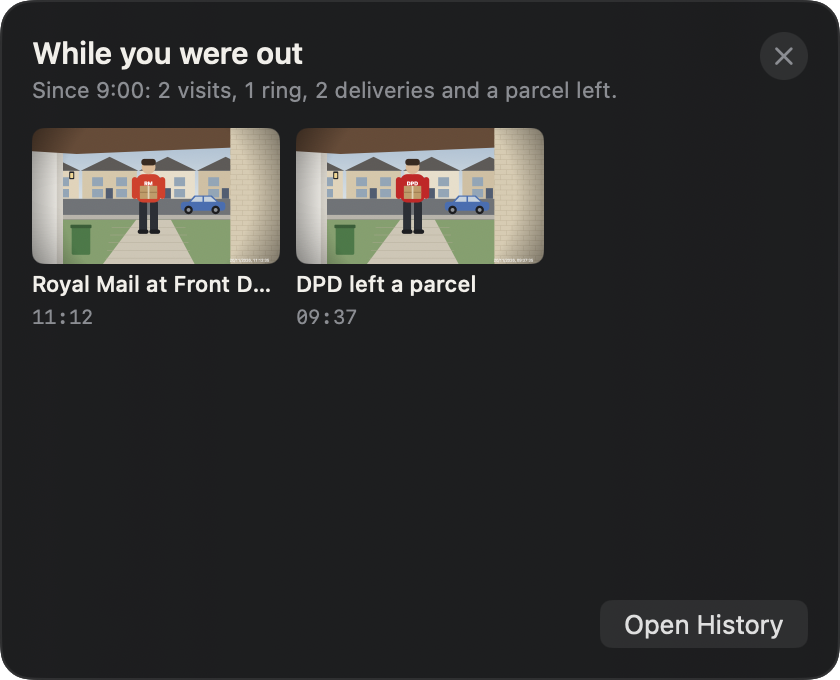

# Around the house

Smaller things Doorstep does to fit around your day.

## Ask your door

Type a question in History's search box and Doorstep answers it from what it has seen:

- *Did DPD come today?*
- *When did the postie come?*
- *How many times did someone ring this week?*
- *Has anyone been in the garden?*

The answer is one sentence; the visits it's based on are underneath. It works on this Mac from Doorstep's own notes on each visit, so it knows carriers, parcels, knocks, dogs, number plates you've named and what visitors said (if transcripts are on). Anything it can't put a name to is answered "No", so try the plain search too.

## While you were out

Lock your Mac or let it sleep for 45 minutes or more, and when you come back Doorstep shows a small card of the visits, rings and parcels you missed. **Open History** takes you to them. Nothing to show, no card. Switch it off in **Settings › Alerts**.

## Quiet on calls

If any app is using your microphone or camera (a Teams, Zoom or FaceTime call), Doorstep's alerts arrive without sound and nothing is said out loud. The doorbell still pops up, silently. **Settings › Alerts › Keep quiet while I'm on a call**.

## A camera goes offline

Doorstep tells you straight away when a camera that was online drops off, not just once a day. It can mean a flat battery or lost Wi-Fi, or someone unplugging or covering it. In Away mode the alert is marked urgent.

## When nobody's home

In Away mode, someone hanging around a camera (see Loitering in **Settings › Alerts**) gets an urgent alert with their picture on your Mac and your phone. You can also have Doorstep:

- switch on the camera's light (cameras with lights), and
- say a warning through the camera ("Hello. You're on camera and this is being recorded."), in your Mac's voice.

Both are off until you switch them on. The siren is never set off automatically.

## Post, bins and bank holidays

In **Settings › Parcels**:

- **The post.** After about a week, Doorstep knows when Royal Mail usually comes. On a delivery day, if they're well past their usual time, it tells you. Sundays and bank holidays are skipped.
- **Bin day.** Add each bin, its day, and whether it's every week or every other week. You get a reminder the evening before. Councils don't share one free feed, so you type these in once.
- **Bank holidays** come from GOV.UK (choose England and Wales, Scotland or Northern Ireland). If a bin day lands near one, the reminder says so.

## Desktop widget

Right-click your desktop, choose **Edit Widgets**, and search for Doorstep. It shows your cameras' latest pictures and a line about today, in small, medium or large. It updates every few minutes while Doorstep is running, using pictures Doorstep already has (it doesn't wake your cameras).

## Keyboard

Press **⌘`** from any app to open Doorstep's menu bar panel. Change it in **Settings › General › Keyboard**.
