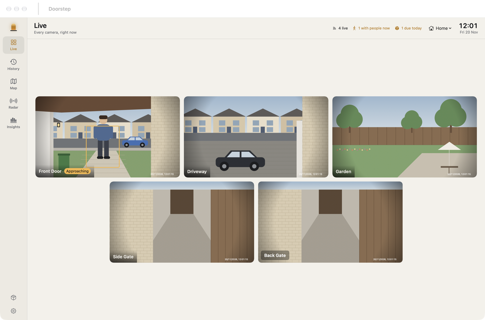

# Other cameras (not Ring)

Doorstep can show cameras from other makers next to your Ring ones: Reolink, Tapo, Hikvision, Dahua, Amcrest, UniFi, and most cameras that say "ONVIF" or "RTSP" on the box. Video goes straight from the camera to your Mac. No cloud, no subscription.

## Add one

Open **Settings › General › Other cameras**.

**If the camera supports ONVIF** (most do):

1. Click **Find cameras on my network**. Cameras that answer appear in the list.
2. Click **Add…** next to yours, type its user name and password, and click **Save**. Doorstep asks the camera for its video address and checks a picture comes through.
3. Leave **Use the camera's smaller stream** on unless the camera is on a wired connection. It's lighter on Wi-Fi and looks the same in a tile.

**If it isn't found**, click **Add by address…** and type its RTSP address. Your camera's app or manual will have it. Some common ones:

| Make | Address |
|---|---|
| Reolink | `rtsp://CAMERA-IP:554/h264Preview_01_sub` |
| Tapo | `rtsp://CAMERA-IP:554/stream2` (make a "camera account" in the Tapo app first) |
| Hikvision | `rtsp://CAMERA-IP:554/Streaming/Channels/102` |
| Dahua, Amcrest | `rtsp://CAMERA-IP:554/cam/realmonitor?channel=1&subtype=1` |
| UniFi Protect | Turn on RTSP for the camera in Protect and copy the address it shows |

Click **Test** to see a picture before you save.

## What works with them

- **Live**: they appear in the Doorstep window's Live section.
- **People**: with **Tell me when it sees a person** on, Doorstep watches the picture and alerts you (with the picture) at most every two minutes per camera. It follows Quiet mode, keeps quiet while you're on a call, and is more urgent in Away mode.

Not yet: History, recording on your Mac, zones and the other "who was it" features. Those are Ring-only for now.

## Good to know

- Video must be H.264 or H.265, which nearly every camera uses.
- Passwords are kept in your Mac's Keychain.
- The first time you search, macOS asks whether Doorstep may look on your local network. Say yes, or searching won't find anything (adding by address still works).
