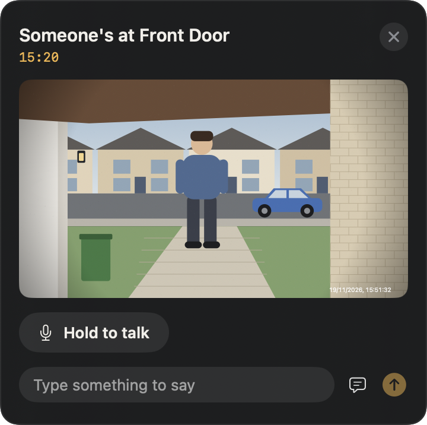

# Say it at the door

Doorstep can speak through your doorbell for you. You type, your Mac says it, and your microphone stays off.

## Answer by typing

1. When someone rings, the doorbell pops up in the corner of your screen.
2. Click **Type something to say**, write your line and press Return.
3. Your Mac says it through the doorbell. It takes a couple of seconds to connect, and the pop-up tells you when it has been said.

The speech bubble next to the box holds your saved replies. Click one to say it straight away.

**Hold to talk** is still there if you'd rather use your own voice. That is the only thing that turns your microphone on.

## Saved replies

Open **Settings › Replies**. Add the lines you use most, hear any of them on your Mac with the speaker button, and delete the ones you don't want.

The voice is one that's already on your Mac. For a more natural one, open **System Settings › Accessibility › Spoken Content › System Voice › Manage Voices** and download an Enhanced or Premium voice. Doorstep picks the best one you have.

## Answer couriers for you

This is off until you switch it on, in **Settings › Replies › Answer couriers for you**.

When your doorbell rings and it looks like a delivery, Doorstep says your sentence once, then sends you an alert telling you what it said and to whom.

You choose when it's allowed to speak:

- **Only in Away mode**, or any time.
- **Only when I'm expecting a parcel**: it stays quiet unless there's a parcel on your Parcels list.
- **Only if Doorstep recognises a courier**: it looks at the picture for a few seconds first. This isn't perfect. With it off, Doorstep answers anyone who rings.

Good to know:

- It only ever says the sentence you wrote. Don't write that nobody's home.
- It speaks once per ring, and not again at that door for ten minutes.
- It needs a Ring doorbell (cameras without a button never "ring").
- Settings shows a line telling you whether it would speak right now, and why not.

## In Shortcuts and Siri

There's a **Say at Door** action: give it a sentence and a camera. Use it in any Shortcut, for example "when I leave work, say 'Back in ten minutes' at the front door".

## Is anything sent anywhere?

No. The voice is made on your Mac and goes straight into the same live connection Doorstep already uses to talk to your camera.
